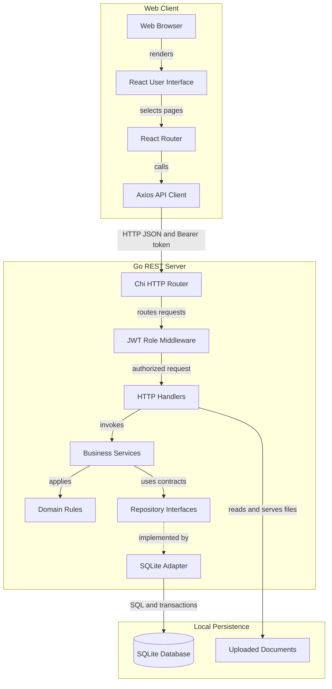
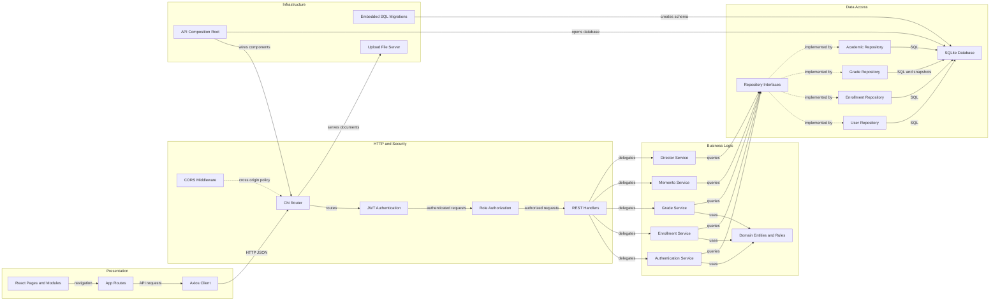

# Architecture Diagram

This diagram summarizes how the school management system connects its browser interface, Go REST API, and SQLite persistence. The second view focuses on the principal component dependencies and cross-cutting concerns.

## Application Architecture

<!-- mermaid-checked: no \n, no em-dash/en-dash, no {} in labels, subgraphs are id["label"], arrows are -->|"label"|, all subgraphs closed by end, ids unique -->

### Technology Stack Summary

| Layer | Technology | Version | Purpose |
|---|---|---|---|
| Web UI | React | 19.x | Renders public pages and school modules |
| Web build and development | Vite | 8.x | Serves the frontend in development and builds static assets |
| Client routing | React Router | 7.x | Maps browser paths to pages |
| HTTP client | Axios | 1.x | Calls the REST API and sends bearer tokens |
| API server | Go | 1.26.10 module target | Runs handlers and business services |
| HTTP routing | Chi | 5.x | Matches REST paths and applies router middleware |
| Relational storage | SQLite with modernc.org/sqlite | 1.61.1 | Persists accounts, admissions, grades, and academic data |
| Authentication | JWT and bcrypt | Go modules | Signs access tokens and verifies password hashes |

### Data Storage & External Services

SQLite is the persistent store and is opened or created at startup. Numbered SQL migrations are embedded in the Go backend and applied on startup; demonstration users and school records are seeded when the database has no users. Uploaded documents are stored on the backend filesystem and served under `/uploads`. There is no separate cache, message broker, or required external service in the current local architecture.

### Key Architectural Decisions

- The frontend communicates with Go through JSON HTTP endpoints; it does not connect directly to SQLite.
- Services depend on repository contracts while the SQLite package provides the concrete storage adapter.
- Authentication and role checks are enforced by backend middleware; frontend route checks only control the user experience.
- Admission requests and normalized academic enrollments remain distinct data models; attendance and timetable screens are not yet backed by write endpoints.

## Component Relationships

<!-- mermaid-checked: no \n, no em-dash/en-dash, no {} in labels, subgraphs are id["label"], arrows are -->|"label"|, all subgraphs closed by end, ids unique -->

### Component Inventory

| Component | Layer | Type | Responsibility |
|---|---|---|---|
| `AppRoutes` and React pages | Presentation | Router and UI | Maps URLs and renders workflows |
| Axios client | Presentation | HTTP client | Adds API base URL, bearer token, timeout, and error mapping |
| Chi router | HTTP | Router | Maps paths and installs shared middleware |
| Authentication and role middleware | HTTP security | Middleware | Validates JWT and limits protected operations by role |
| Handlers | HTTP | Controllers | Decode requests, call services, and write responses |
| Services | Business logic | Use cases | Coordinate authentication, enrollment, grades, history, and academic administration |
| Domain entities and patterns | Domain | Business rules | Represents core concepts and State or Memento behavior |
| Repository interfaces | Data boundary | Ports | Define persistence operations required by services |
| SQLite repositories | Data access | Adapters | Execute queries and transactions against SQLite |
| API composition root | Infrastructure | Bootstrap | Creates and connects routers, handlers, services, repositories, and database |
| SQL migrations | Infrastructure | Schema versioning | Builds and upgrades the local database schema |
| Upload file server | Infrastructure | Static files | Exposes uploaded documents through `/uploads` |
