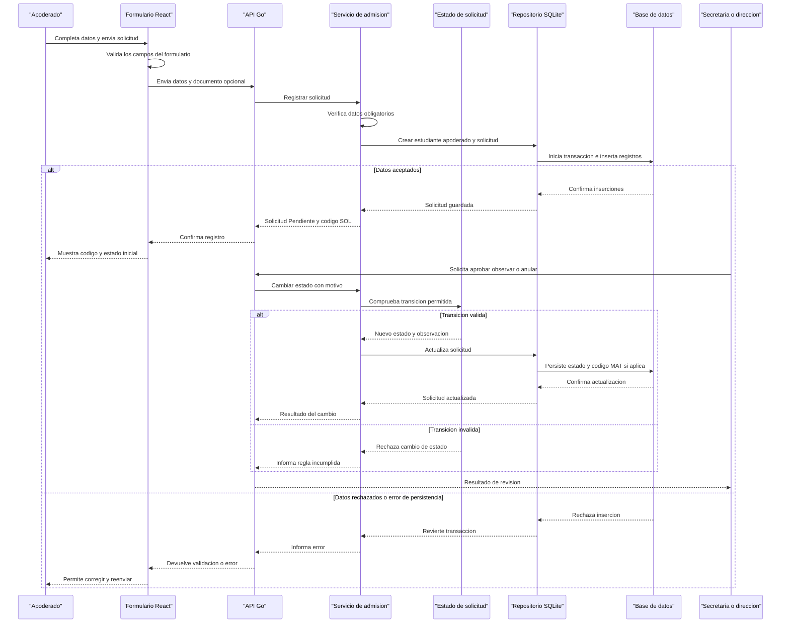

# Core Business Workflows

El sistema acompaña el proceso de admisión de estudiantes, la revisión de sus solicitudes y el registro académico de calificaciones. Dirección administra las cuentas y asignaciones; Secretaría revisa expedientes; docentes consultan sus grupos y actualizan notas.

## Domain Entities

| Entity | Service / Bounded Context | Description | Key Relationships |
|---|---|---|---|
| Solicitud de admisión | Admisión | Expediente recibido para evaluación e ingreso | Reúne un estudiante, un apoderado, grado, sección, documento y pago |
| Estudiante | Admisión y registro académico | Persona inscrita en el expediente | Puede tener apoderado, solicitudes y calificaciones |
| Apoderado | Admisión | Contacto responsable del estudiante | Se vincula al estudiante |
| Pago | Admisión | Constancia de pago asociada al expediente | Pertenece a una solicitud |
| Usuario | Identidad y acceso | Cuenta de Secretaría, Dirección o Docencia | El rol determina las operaciones autorizadas |
| Asignatura y asignación docente | Administración académica | Cursos y grupos que atiende cada docente | Una asignación relaciona docente, asignatura, grado y sección |
| Calificación | Evaluación académica | Notas B1-B4, promedio y versión vigente | Se relaciona con estudiante, docente y asignatura |
| Memento de calificación | Historial académico | Instantánea inmutable de una versión de notas | Pertenece a una calificación y registra autor, fecha y acción |
| Matrícula académica, asistencia y horario | Modelo académico preparado | Estructuras normalizadas para futuras operaciones escolares | Se relacionan con estudiante, sección, asignación y periodo |

## Service-to-Domain Mapping

| Service | Domain Context | Owned Entities | External Dependencies |
|---|---|---|---|
| `AuthService` | Identidad y acceso | Usuario y sesión JWT | `UserRepository`, bcrypt y firma JWT |
| `EnrollmentService` | Admisión | Solicitud, estudiante, apoderado y pago | `EnrollmentRepository` y State |
| `GradeService` | Evaluación académica | Calificación y promedio | `GradeRepository` y Memento |
| `MementoService` | Historial académico | Instantáneas y versiones de notas | `GradeRepository` |
| `DirectorService` | Administración académica | Usuarios, asignaturas, secciones y asignaciones | `UserRepository` y `AcademicRepository` |
| Handlers HTTP | Presentación de la API | Solicitudes y respuestas | Servicios, Chi y middleware |

Los servicios comparten una única base SQLite mediante repositorios; no hay microservicios ni sincronización entre procesos. Las interfaces de `internal/repository` establecen el límite de persistencia. El adaptador SQLite es la fuente de verdad de los datos. El modelo académico normalizado está migrado y sembrado, pero varias de sus entidades aún no tienen operaciones completas de API.

## Primary Workflows

### Workflow 1: Enviar y revisar una solicitud de admisión

1. El apoderado completa las tres etapas del formulario público: estudiante, apoderado y documento.
2. El frontend valida los campos requeridos de cada etapa y conserva el borrador mientras se navega.
3. Envía los datos como `multipart/form-data` a `POST /api/enrollments/public`; el documento es opcional.
4. `EnrollmentHandler` procesa el formulario y el archivo permitido; `EnrollmentService.RegisterPublic` revisa los campos obligatorios y crea el estudiante, el apoderado y la solicitud inicial Pendiente.
5. `EnrollmentRepository.Create` inserta las tres entidades dentro de una transacción. Si una inserción falla, revierte el conjunto.
6. Secretaría o Dirección consulta la lista y el detalle, revisa el documento y solicita un cambio de estado con motivo.
7. El objeto `Enrollment` delega la decisión a su State concreto. Si la transición es válida, se guarda el nuevo estado y observación. Al aprobar una solicitud SOL se asigna un código MAT oficial.

### Workflow 2: Registrar o modificar una calificación

1. Docente inicia sesión y solicita sus calificaciones; el backend filtra por el ID incluido en el JWT, con filtros opcionales por grado y sección.
2. El frontend selecciona sección, curso y bimestre; la nota editada permanece como borrador local hasta pulsar Guardar.
3. `GradeService.SaveGrade` valida la escala de 0 a 20 y busca si ya existe la combinación estudiante-asignatura.
4. Para una calificación nueva, crea la entidad en versión 1. Para una existente, actualiza sus notas, incrementa la versión y recalcula el promedio.
5. `Grade.CreateMemento` captura la instantánea. El repositorio persiste nota e instantánea en la misma transacción.
6. Docente consulta historial, deshace, rehace o restaura una versión concreta. `MementoService` valida que exista y corresponda a la calificación antes de restaurarla.

### Workflow 3: Administrar cuentas, asignaturas y asignaciones

Dirección consulta usuarios y catálogos, registra cuentas docentes o administrativas, activa o desactiva usuarios, crea asignaturas y asigna docentes a curso, grado y sección. Las claves nuevas se almacenan con bcrypt. Se pueden eliminar asignaciones; el backend no ofrece edición ni eliminación de usuarios o asignaturas.

### Workflow 4: Registrar asistencia o programar horarios

Las pantallas muestran los alumnos o las asignaciones disponibles y permiten filtrar/preparar la vista. No hay endpoints para persistir asistencia ni para crear/consultar horarios completos. La selección de asistencia es una previsualización local; el botón Guardar está deshabilitado. La vista semanal muestra que no hay horarios registrados en lugar de inventar datos.

## Cross-Service Data Flows

El flujo es interno a un único backend: el router pasa la solicitud al handler; el handler llama a un servicio; el servicio usa entidades y reglas de dominio y consulta interfaces de repositorio; el adaptador SQLite lee o escribe datos. No hay llamadas entre servicios externos, eventos, colas, cache ni fallback de microservicios.

En admisión, la transacción de persistencia agrupa estudiante, apoderado y solicitud. En calificaciones, una transacción agrupa la nota y su Memento. Los archivos se guardan en el sistema de archivos del backend y se sirven mediante `/uploads`; la ruta del documento se almacena en la solicitud.

## Business Workflow Sequence

<!-- mermaid-checked: every participant uses `participant Id as "Label"`, no \n in aliases/messages/notes, every alt/opt/loop closed by end, no `:` inside any alias -->

## Business Rules & Decision Logic

- **Solicitud nueva:** nombres, apellidos y DNI del estudiante; nombres y teléfono del apoderado son obligatorios. Si falta grado, el servicio asigna el primer grado por defecto. El código de solicitud comienza con `SOL`; el estado es Pendiente.
- **Documento:** el formulario acepta PDF, PNG o JPEG. El handler genera un nombre de archivo en `uploads`. Si no se adjunta documento, asigna la ruta al PDF de ejemplo. La validación actual del archivo se basa principalmente en su extensión.
- **State de admisión:** Pendiente puede aprobarse, observarse o anularse. Observada puede aprobarse, volver a Pendiente o anularse. Aprobada no se puede volver a observar ni a Pendiente; puede anularse. Anulada es terminal. La interfaz llama Retirar a una operación que actualmente se envía como Anulada; no existe un estado Retirada implementado en la API.
- **Código de formalización:** al aprobar una solicitud `SOL`, el servicio genera un código `MAT`. El cambio de estado y código se guarda en la solicitud.
- **Eliminación de admisión:** el servicio impide eliminar una solicitud Aprobada para preservar la auditoría. La anulación conserva el expediente.
- **Pago:** si el monto recibido no es positivo, el servicio asigna el monto predeterminado; si no se recibe número de comprobante, genera uno. El repositorio actualiza o inserta un único pago por solicitud y actualiza el estado de pago.
- **Calificaciones:** cada B1-B4 se valida en el rango 0-20. El promedio se calcula usando las notas mayores a cero y se redondea a una cifra decimal; por tanto, un cero es válido como calificación, pero actualmente se excluye del cálculo del promedio.
- **Memento:** cada creación o edición genera un snapshot. La nota y snapshot se guardan en una transacción; después de deshacer y guardar una nueva edición, el repositorio elimina las versiones futuras para iniciar una nueva rama de historial.
- **Autorización:** middleware valida JWT y los roles permitidos en el backend. Secretaría/Dirección gestionan solicitudes; Docencia/Dirección gestionan notas; solo Dirección administra cuentas, asignaturas y asignaciones.
- **Atomicidad:** estudiante, apoderado y solicitud se crean juntos; calificación e instantánea se crean/actualizan juntos. Un fallo en la transacción no debe dejar solo una parte del cambio.
- **Límites de cobertura:** las rutas de infraestructura existen para más operaciones que los botones presentes en las pantallas. El documento CRUD detalla qué se puede hacer desde la interfaz, qué permite el API y qué sigue pendiente.
