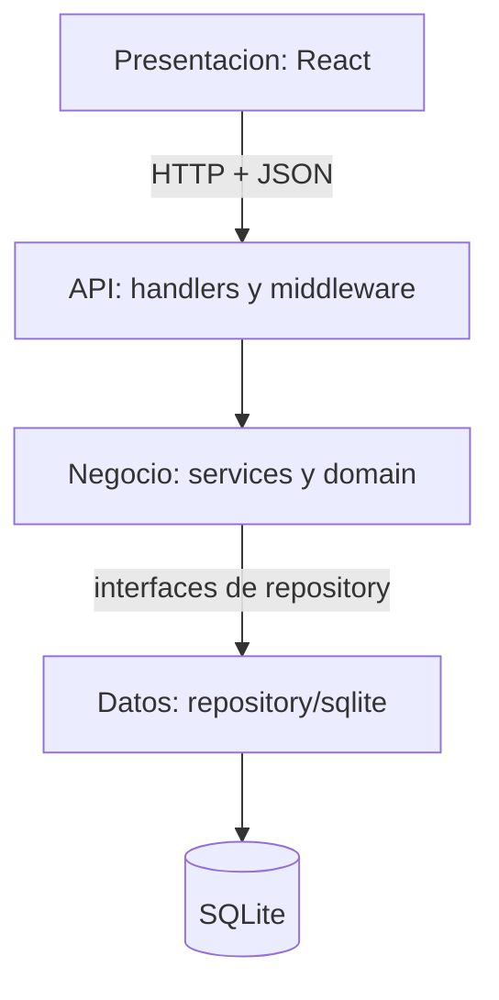

# Arquitectura del sistema

## Alcance

La aplicacion conserva los flujos existentes de solicitudes de ingreso y calificaciones bimestrales. El modelo academico del documento de arquitectura se agrega de forma aditiva: una solicitud aprobada puede convertirse en una matricula academica, y las notas academicas se relacionan con matriculas y asignaciones sin alterar el historial de calificaciones existente.

## Capas y dependencias

- **Presentacion:** `frontend/src/pages`, `layouts`, `components`, `features` y `api`. Las vistas no acceden directamente a SQLite y las peticiones HTTP pasan por el cliente Axios de `src/api`.
- **API:** `backend/internal/handler` recibe HTTP, valida el formato de la peticion y convierte los errores de negocio en respuestas HTTP.
- **Negocio:** `backend/internal/service` coordina casos de uso; `backend/internal/domain` contiene entidades y patrones State/Memento sin dependencias de HTTP o SQLite.
- **Datos:** `backend/internal/repository/interfaces.go` define los puertos. `backend/internal/repository/sqlite` implementa persistencia y transacciones.
- **Persistencia:** `backend/migrations` contiene migraciones SQL numeradas e idempotentes para instalaciones nuevas y existentes.

El punto de composicion y arranque es `backend/cmd/api/main.go`. La regla de dependencias es handler -> service -> interfaces de repository <- repository/sqlite. El dominio no importa handlers ni persistencia.

## Datos academicos

Las tablas de compatibilidad `enrollments`, `grades` y `grade_mementos` mantienen los flujos actuales. El esquema academico adicional usa:

| Tabla | Responsabilidad |
|---|---|
| `docentes` | Perfil academico vinculado a una cuenta |
| `cursos` | Cursos del colegio, vinculables a asignaturas existentes |
| `asignaciones` | Relacion docente-curso-seccion |
| `horarios` | Dia, hora y aula de una asignacion |
| `matriculas` | Matricula academica anual por alumno y seccion |
| `notas` | Nota de un alumno por asignacion y periodo (1-4), escala 0-20 |
| `nota_historial` | Mementos de cambios de notas por autor y version |
| `asistencias` | Estado diario de asistencia para una matricula y horario |

Las migraciones copian de forma idempotente catalogos y datos compatibles del esquema anterior; las solicitudes aun no aprobadas no se convierten en matriculas academicas.

## Patrones

- **State:** las solicitudes actuales conservan sus estados de admision y restricciones. La matricula academica utiliza `PENDIENTE`, `ACTIVA`, `RETIRADA`, `ANULADA` y `FINALIZADA`, con transiciones controladas por dominio.
- **Memento:** las calificaciones bimestrales actuales guardan cada version en la misma transaccion que actualiza la nota. El historial academico separado permite auditar cambios por periodo. Un fallo al guardar el memento revierte el cambio.

## Frontend

`App.jsx` monta el router; `pages/AppRoutes.jsx` declara las rutas; `layouts/AppLayout.jsx` comparte el marco publico; `features` mantiene las vistas por rol; `components` contiene piezas compartidas; `api` centraliza Axios y el token; `styles/tokens.css` mantiene las variables visuales.

## Flujo y calidad

El equipo trabaja en ramas cortas por funcionalidad y revisa cambios mediante Pull Request antes de integrar. Convenciones: Go con `gofmt`, componentes React en PascalCase, hooks con prefijo `use`, tablas y columnas en `snake_case`. Una tarea se considera terminada si compila, respeta las capas, valida entradas, presenta errores comprensibles y tiene pruebas del dominio para State/Memento.

La distribucion de trabajo del documento se mantiene: arquitectura y dominio/patrones; backend para handlers, servicios, repositorios y pruebas; frontend para pantallas e integracion; diseno para guia visual, wireframes y componentes. Las reuniones y asignaciones concretas dependen del equipo y se acuerdan fuera del codigo.
